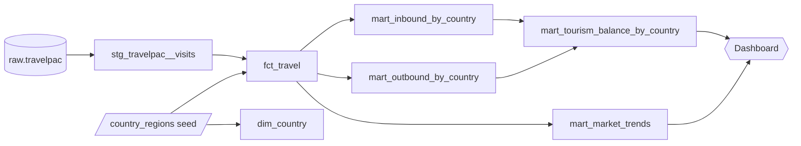

# UK Travel Flows 2009–2019: a dbt + DuckDB analytics project

An end-to-end analytics engineering project on the ONS **Travelpac** dataset: raw survey extract → tested dbt models → analysis marts → dashboard-ready exports.

The project models eleven years of UK inbound and outbound travel (visits, nights, spend) by country, purpose, mode, age, sex and length of stay, and uses it to answer concrete questions: which markets grew, what drove that growth, how much a visitor is really worth, and how migration shows up in travel flows.

---

## Contents

- [Stack](#stack)
- [Data](#data)
- [Architecture](#architecture)
- [Project structure](#project-structure)
- [Getting started](#getting-started)
- [Data quality and testing](#data-quality-and-testing)
- [Findings so far](#findings-so-far)
- [Methodological notes](#methodological-notes)
- [Roadmap](#roadmap)

---

## Stack

| Layer | Tool |
|---|---|
| Transformation | dbt 2.x (Fusion engine), VS Code dbt extension |
| Warehouse | DuckDB (single local file) |
| Loading and exports | Python (pandas, duckdb) |
| Packages | dbt_utils |
| Consumption | Power BI via Parquet exports (Evidence planned) |

## Data

**Source:** [Travelpac](https://www.ons.gov.uk/), Office for National Statistics (UK), 2009–2019 labelled extract, derived from the International Passenger Survey (IPS). Published under the UK Open Government Licence.

Each row is a published cell: a combination of year, quarter, residence group (UK residents / overseas residents), mode, country, purpose, package, age, sex and length of stay, with weighted **visits**, **nights**, **spend (GBP)** and the unweighted **sample** count.

The raw files are not committed. Download the labelled Excel file from ONS and place it in the parent folder of the project before running the load script.

## Architecture



| Layer | Purpose | Materialization |
|---|---|---|
| **Sources** | Raw Travelpac table, loaded once by Python, never edited | table (`raw` schema) |
| **Staging** | One-to-one with the source: renaming, type casting, nothing else | view |
| **Seeds** | Reference data maintained in the repo (country to region mapping) | table |
| **Marts: core** | `fct_travel` at the original cell grain, enriched with seeds; `dim_country` | table |
| **Marts: insights** | Aggregated, purpose-built tables for analysis and the dashboard | table |
| **Analyses** | Exploratory SQL, compiled but not materialized; promoted to marts once stable | – |

**Conventions**

- Staging never filters, joins or aggregates. Filtering by direction (inbound / outbound) is an analytical decision and lives in the marts.
- Every join between aggregated tables happens at an identical grain, and every joined mart carries a grain test.
- Ratios are computed as ratios of sums (`sum(spend) / sum(visits)`), never as averages of row-level ratios.
- Rounding is left to the presentation layer.

## Project structure

```
travelpac/
├── analyses/                 exploratory SQL (CAGR, spend decomposition, diaspora flows)
├── models/
│   ├── staging/
│   │   ├── _sources.yml
│   │   ├── _models.yml
│   │   └── stg_travelpac__visits.sql
│   └── marts/
│       ├── _models.yml
│       ├── _exposures.yml
│       ├── fct_travel.sql
│       ├── dim_country.sql
│       ├── mart_inbound_by_country.sql
│       ├── mart_outbound_by_country.sql
│       ├── mart_tourism_balance_by_country.sql
│       └── mart_market_trends.sql
├── seeds/
│   ├── _seeds.yml
│   └── country_regions.csv   62 Travelpac countries mapped to UN Tourism regions
├── scripts/
│   ├── load_raw.py           Excel → raw.travelpac in DuckDB
├── tests/                    singular tests (validity, reconciliation, outliers)
├── dbt_project.yml
└── profiles.yml              DuckDB connection (no credentials)
```

## Getting started

**Prerequisites:** Python 3.10+, dbt 2.x (Fusion), and the Travelpac labelled Excel file in the folder above the project. On Fusion, `dbtf` and `dbt` are the same command.

```bash
# 1. Python dependencies for loading and exporting
pip install pandas openpyxl duckdb

# 2. Load the raw extract into DuckDB
python scripts/load_raw.py

# 3. Check the connection, then build seeds, models and tests in dependency order
dbt debug
dbt build

# 4. Export reporting tables for Power BI
python scripts/export_marts.py
```

> **DuckDB version note.** `pip install duckdb` currently installs DuckDB 2.0, which writes a newer storage format than the DuckDB driver bundled with dbt can read. `load_raw.py` therefore opens the file with `storage_compatibility_version = "v1.0.0"`. If you see `version number 999` from `dbt debug`, delete `travelpac.duckdb` and rerun the load script.

**Rebuilding from scratch** is a single sequence, which doubles as a check that the database is fully reproducible from code:

```bash
rm travelpac.duckdb          # PowerShell: Remove-Item travelpac.duckdb
python scripts/load_raw.py
dbt build
```

## Data quality and testing

| Test | Where | What it protects against |
|---|---|---|
| `not_null`, `accepted_values` | staging, seeds | Missing keys, unexpected labels, typos in hand-edited seeds |
| `unique` on `country` | seed | Duplicate mapping rows that would silently double totals in joins |
| `relationships` country → seed | staging | Countries in the data with no region mapping |
| `assert_valid_merging` | joined marts | Fan-out: the join multiplying rows when grains do not match |
| `assert_balance_reconciles` | singular | Totals after the inbound/outbound join must equal totals before it, catching both fan-out (too high) and dropped rows (too low) |
| `assert_valid_year` | singular | Years outside the possible range |
| `warn_spend_outliers` | singular, `severity: warn` | Cells whose spend per night is more than 5× or less than ⅕ of the median for the same country and purpose |

The fan-out and reconciliation tests exist because both problems happened during development: a join on country alone multiplied totals by the number of travel modes. The tests make sure it cannot happen silently again.

## Findings so far

These are descriptive results from survey estimates. They are framed as "consistent with", not as causal claims; see the methodological notes.

### 1. Fastest-growing inbound markets, 2009–2019

Compound annual growth in visits, computed from the two endpoint years:

| Market | CAGR | Visits 2009 → 2019 |
|---|---|---|
| China (excl. Hong Kong) | ~18% | ~190k → ~1.0m |
| Romania | ~16% | ~210k → ~900k |
| Thailand | ~10% | |
| Hong Kong | ~9% | |
| United Arab Emirates | ~9% | |

Residual groups ("Other Asia", "Other Middle East") are excluded from rankings. A more robust version using three-year averages at each end is in progress (see roadmap).

### 2. What drove that growth

Decomposing each market's added visits by purpose shows very different engines:

- **China:** holiday travel accounts for roughly two thirds of the added visits.
- **Romania:** business travel accounts for just over half, visiting friends and relatives (VFR) for about a quarter.

### 3. Migration shows up in travel flows

After work restrictions for Romanian and Bulgarian citizens were lifted in January 2014, the data shows a pattern consistent with a growing diaspora, with Poland (whose diaspora dates from 2004) as a comparison:

- **Bulgaria:** inbound business visits rose 72% in 2014 alone (vs 2013), while inbound VFR stayed flat until 2015 and then rose to +56% (2016) and +80% (2017): a lag of about two years.
- **Poland:** business and VFR moved together, peaking in 2016 and dipping in 2017, which is what a mature diaspora would look like.
- **Romania, measured from the other direction:** VFR trips by UK residents *to* Romania grew from ~180k (2013) to ~860k (2017), almost fivefold, starting immediately in 2014. Inbound VFR grew 2.5× over the same period, so family travel runs mostly from the diaspora back home, not the other way.
- **Asymmetric business travel:** inbound business from Romania rose ~2.5× by 2016 while outbound business barely moved until 2016, which fits labour mobility better than growing trade links.

### 4. Spend per trip is mostly length of stay

Study trips top every spend-per-trip ranking, largely because they are long. Spend per trip is decomposed as

```
spend per trip = nights per trip × spend per night
```

and the insight marts rank markets by spend per night, which compares visitor value without the length-of-stay effect.

### 5. Data quality observations

- **Mexico, holiday, 2010:** spend per trip of ~£7,500 against ~£400–560 in other years. Nights per trip are normal, so the anomaly is in spend (~£1,140 per night vs ~£65–125). Flagged by the outlier test and excluded from per-trip metrics.
- **Small samples:** high spend-per-trip values for China study trips in 2016–2017 disappear once cells with 50 or fewer respondents are excluded.
- **Channel Islands:** visits are null while spend is populated; to be checked against the Travelpac manual.

## Methodological notes

- **Survey estimates, not counts.** All figures are weighted IPS estimates. Small cells (a single market in a single quarter) can rest on a few dozen interviews, so thresholds use the unweighted `sample` column, and small markets should be compared on multi-year averages rather than year-on-year changes.
- **Base-year effects.** 2009 was the trough of the financial crisis, which inflates growth measured from it.
- **Nominal values.** Spend is in current GBP. Comparisons across years should be deflated with the UK CPI (planned as a seed).
- **Spend definition.** Travelpac spend excludes fares to and from the UK; check the Travelpac manual before comparing with sources that include transport.
- **Purpose categories are survey definitions.** "Business" may include short-term work, and visitors staying 12 months or more are migrants and fall outside the visitor estimates (which is why long-term students barely appear under "Study").
- **Residual groups.** "Other …" categories are flagged in the seed (`is_residual_group`) and excluded from market rankings.

## Roadmap

- [ ] Consolidate staging into a single `stg_model__first` model and point all marts at `mart_travel`
- [ ] `mart_market_trends`: CAGR on three-year averages, visits added and share of growth
- [ ] `mart_value_volume`: visits vs spend per night, pooled 2017–2019
- [ ] Ramadan and Gulf seasonality: quarterly share of Gulf visitors as Ramadan moves from Q3 (2009–2011) to Q2 (2017–2019)
- [ ] Brexit and sterling: 2013–2015 vs 2017–2019, with an exchange-rate seed
- [ ] CPI seed for real-terms spend
- [ ] `mart_diaspora_flows`: Romania, Bulgaria and Poland in both directions
- [ ] Sort-order seeds for age and duration bands
- [ ] Dashboard (Power BI and/or Evidence) declared as a dbt exposure
- [ ] CI: run `dbt build` on every push with GitHub Actions

---

**Author:** Ahmed, data analyst and statistician working on tourism and survey data.
